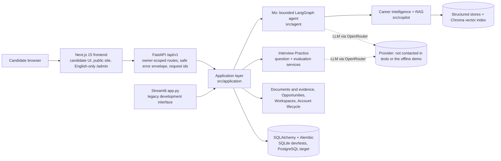
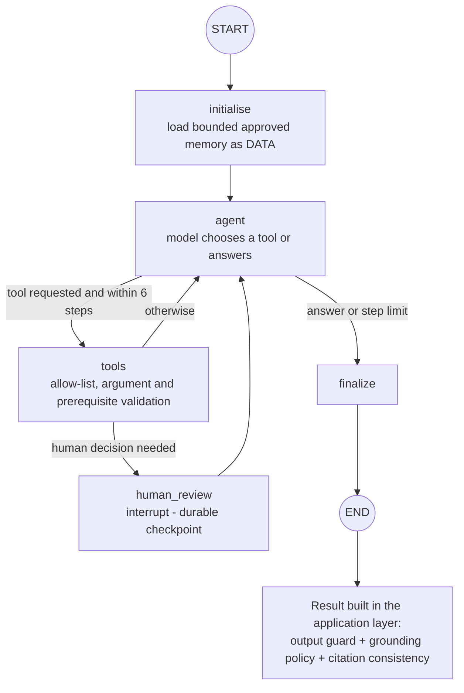
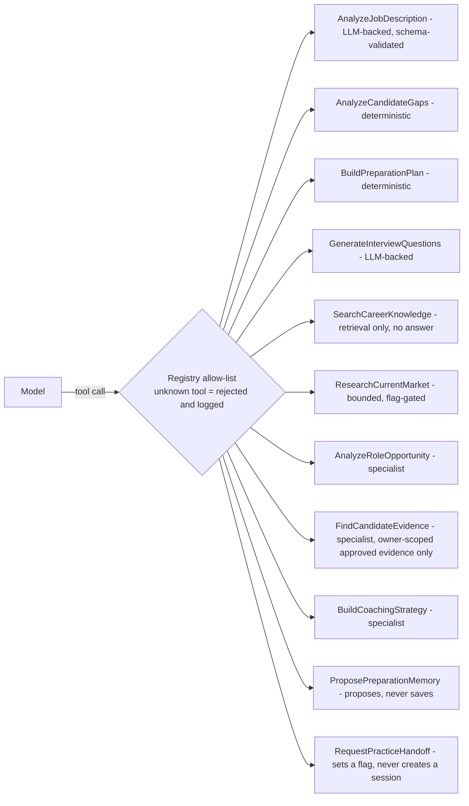
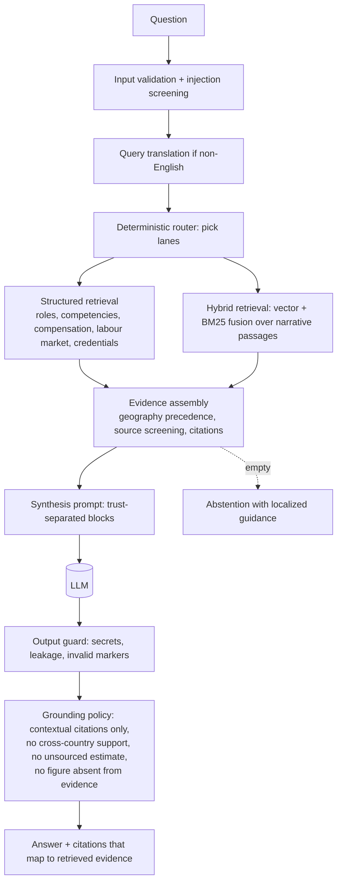
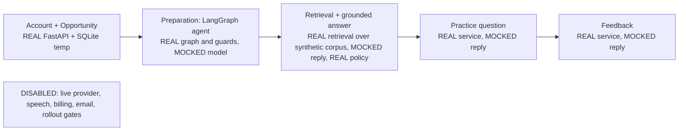

# Architecture Diagrams

Diagrams are Mermaid (rendered by GitHub and most Markdown viewers) and were drawn from the code, not from planning documents: node names come from `src/agent/graph.py`, the tool list from `src/agent/registry.py`, retrieval stages from `src/copilot/service.py`. Each diagram states what is live, mocked or disabled in the offline demonstration.

## 1. System context



## 2. Mo: the LangGraph agent



Human decisions (only three): confirm an ambiguous role, approve a proposed memory, approve the handoff into practice. Resume validates the decision against the pending action before the graph is touched.

## 3. Function calling: the tool registry (11 tools)



## 4. RAG pipeline and grounding



## 5. Data and trust boundaries

```mermaid
flowchart LR
    subgraph Untrusted DATA
      JD[Job description]
      BG[Candidate background]
      DOCS[Uploaded documents]
      RET[Retrieved passages]
      TOOLOUT[Tool results]
    end
    subgraph Trusted
      SYS[System instructions, allow-lists]
      POL[Policies: authorization, grounding, HITL]
    end
    Untrusted DATA --> PROMPT[Prompt blocks labelled as data]
    SYS --> PROMPT
    PROMPT --> LLM[(LLM)]
    LLM --> POL
    POL --> OUT[Candidate-visible output]
    OWN[(Owner-scoped storage)] --- POL
    ADM[Admin control plane] -. metadata only, never candidate content .-> OWN
```

## 6. Offline demonstration: what is real


