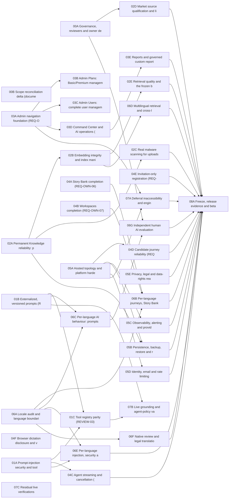

# Dependency Graph (Phase 00)

**Status:** GENERATED from the package definitions. Dependencies mean: the dependent package starts no earlier than the week in which its dependency finishes (merged). Owner decisions and human reviews are shown as external gates.

## Package dependencies

## Dependency order (topological)

00A, 00B, 01A, 01B, 01C, 02A, 02B, 02C, 02D, 02E, 03A, 03B, 03C, 03D, 03E, 04A, 04B, 04C, 05A, 04D, 04E, 04F, 05B, 05C, 05D, 05E, 06A, 06B, 06C, 06D, 06E, 06F, 06G, 07A, 07B, 07C, 08A

## Critical path

Lowest-effort chain: 03A -> 03D -> 03E -> 08A = 26 days. Highest-effort chain: 03A -> 03D -> 03E -> 08A = 39 days. These are lower bounds on elapsed effort no matter how many people work in parallel; they exclude calendar-bound human and legal review.

## Shared modules and safe integration order

| Shared module | Packages that edit it | Safe order |
|---|---|---|
| src/agent/policies.py and the tool-execution path (registry.py, nodes.py) | 01A, 01B, 01C, 04C | 01B, then 01A, then 01C; 04C after 01A |
| src/prompts.py, src/prompt_registry.py, src/config_versions.py | 01B, 06C | 01B before 06C |
| src/copilot/security/ and src/copilot/models.py (RetrievalResult) | 01A, 02B, 06D, 06E | 01A first |
| src/knowledge_admin/ and src/copilot/embeddings.py, retrieval/ | 02A, 02B, 02C, 02D, 02E | 02A, then 02B and 02C, then 02D and 02E |
| frontend/components/admin/AdminShell.tsx and frontend/lib/admin/capabilities.ts | 03A, 03B, 03C, 03D, 03E | 03A first; the rest rebase on it |
| frontend/components/layout/nav-items.ts | 03A only | single owner |
| tests/_admin_matrix.py and the admin role fixture | 03A to 03E | regenerate only when a permission or route changes |
| deploy/docker-compose.staging.yml, Dockerfiles, deploy/scripts | 02A (worker, volumes), 02C (clamd), 05A, 05B | 05A owns the file; 02A and 02C supply fragments |
| Alembic migrations (head 0039_speech_governance) | 03E, 04A, 04B, 04E (new tables) | one migration per PR, sequential heads, never two heads |
| src/application/agent_service.py and Mo UI | 04C, 04D | 04C then 04D |
| i18n catalogues (frontend/lib/i18n/messages) | all frontend packages | add keys to all locales in the same PR (existing rule) |

## External gates (not engineering dependencies)

- Owner decisions: OD-SCOPE-01, OD-HOSTED, OD-BUDGET, OD-GATE-THRESHOLDS, OD-INVITE, OD-MALWARE, OD-PLAN-ENFORCE, OD-ADMIN-NAV, OD-BULK-ACTIONS, OD-REPORT-EXPORT, OD-WS-TRANSFER, OD-LANG-02, OD-LANG-03, OD-LANG-04, OD-COVERAGE, OD-EMBED, OD-US-CONTENT.
- Human and legal: named reviewers (00A), native review and legal translation (06F), independent human evaluation (06G), counsel review (05E), licence review (02D).
