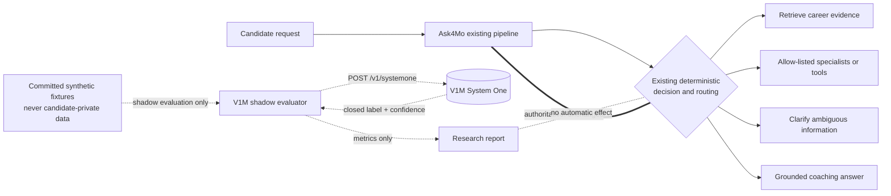
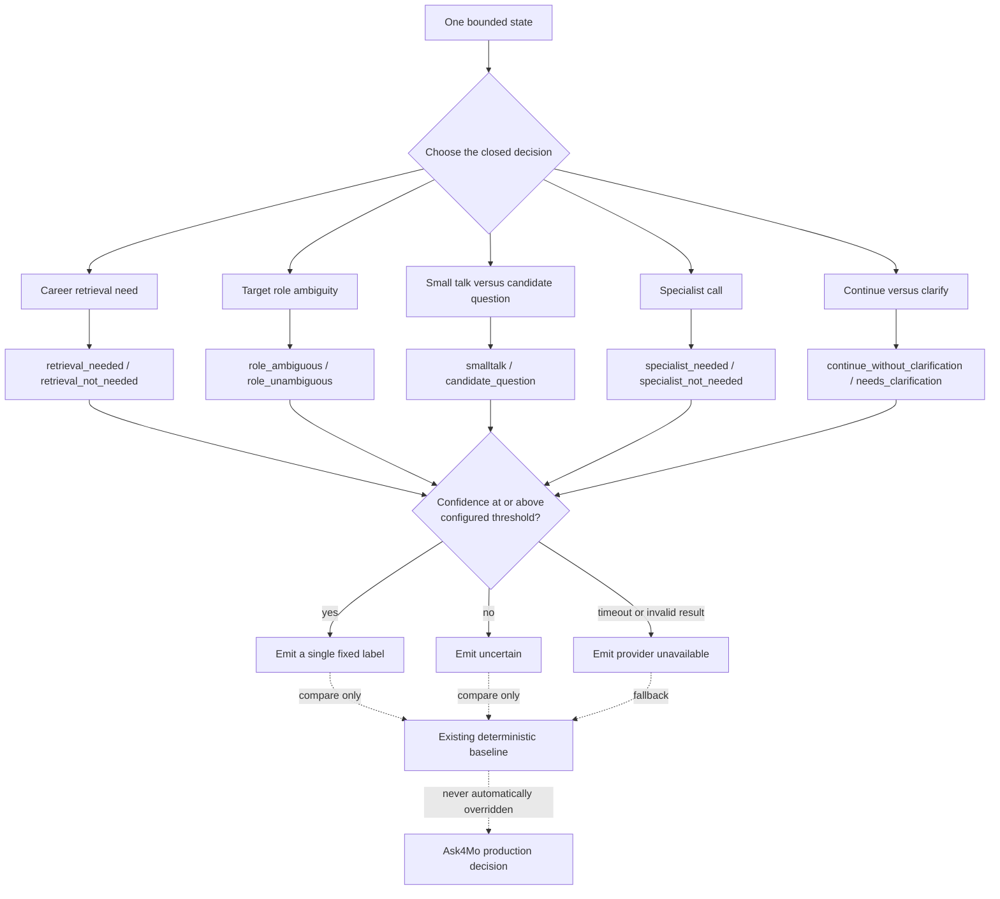
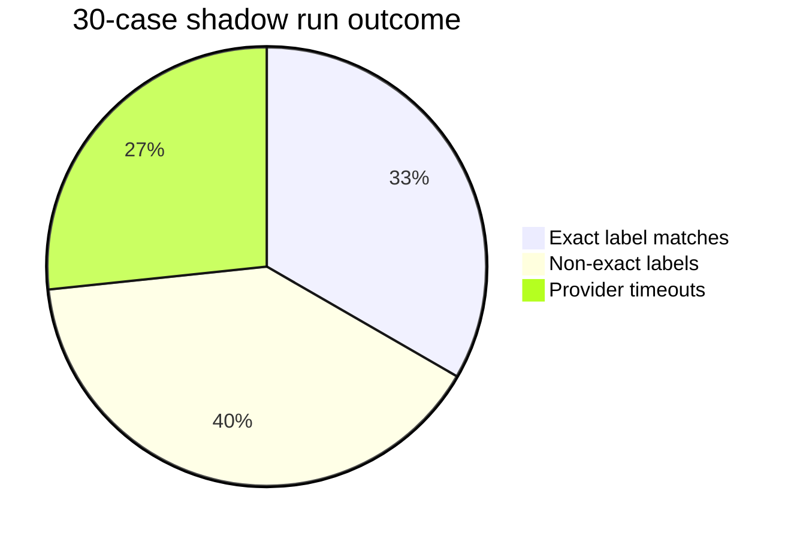
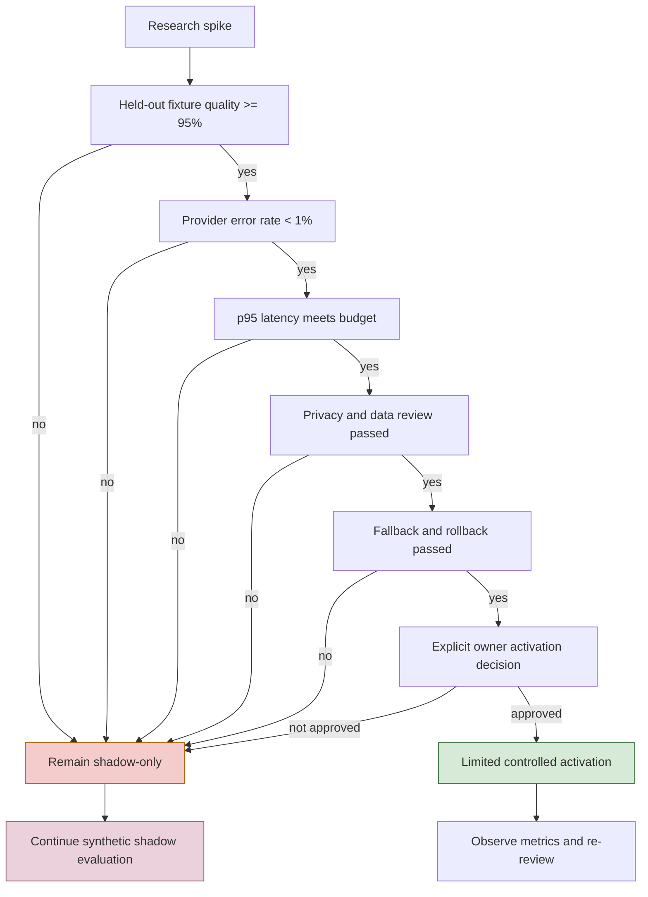

# V1M / JEV shadow research brief

**Status:** Research only  
**Candidate behavior:** Unchanged  
**Production activation:** Not approved  
**Evidence date:** 2026-11-25

## Executive summary

Ask4Mo tested V1M System One as a bounded micro-decision provider. The
initial retrieval-need shadow run did not justify integrating the provider into
candidate routing. V1M remains available behind an opt-in evaluator as a
research spike only.

The implementation does not replace OpenRouter, LangGraph, grounding policy,
deterministic occupation resolution, specialist routing, or human approval.

## End goal

The intended end goal is to reduce low-risk routing overhead by reserving
generative reasoning for substantive coaching work. A decision model may later
provide a fast second opinion for one of five bounded decisions.

The existing deterministic baseline remains the authority. V1M can be evaluated
only as a shadow label and cannot make an interview, retrieve private evidence,
save memory, approve handoff, or alter a candidate answer.

## How the feature fits Ask4Mo

The main Ask4Mo pipeline is never re-routed through V1M. The provider receives
only synthetic fixtures or bounded caller-supplied state for an explicit
research run. Its returned label is recorded for comparison, never written to
candidate state and never used to execute a tool or change an answer.

## Use cases

1. **Career retrieval need**
   - Decide whether the request is likely to need grounded career evidence.
   - Baseline: deterministic intent heuristics and fixed retrieval routing.
   - Benefit if qualified: lower latency or fewer unnecessary retrieval calls.

2. **Target role ambiguity**
   - Decide whether the role is clear or materially ambiguous.
   - Baseline: occupation resolver and repository candidate comparison.
   - Benefit if qualified: earlier clarification and fewer wrong-role answers.

3. **Small talk versus candidate question**
   - Separate greetings and interface remarks from substantive career questions.
   - Baseline: the existing deterministic intent heuristic.
   - Benefit if qualified: a narrower routing decision, not candidate synthesis.

4. **Specialist call**
   - Predict whether an existing specialist is needed for the current context.
   - Baseline: the pure allowlisted specialist recommendation.
   - Benefit if qualified: an advisory second signal that never executes a tool.

5. **Continue versus clarify**
   - Decide whether continuation is safe or required input is missing.
   - Baseline: deterministic role ambiguity and missing-input checks.
   - Benefit if qualified: earlier, explicit clarification instead of guessing.

The closed label sets prevent V1M from producing free-form routing instructions.
Every outcome can fall back to the existing deterministic decision.

## Initial evidence

One synthetic choice-primitive run reached valid V1M responses for 8 of 10
fixtures and exact-label agreement for 4 of 10. The remaining 2 requests
timed out. V1M often classified small-talk-like inputs as retrieval-needed.

An expanded 2026-11-25 shadow run requested 30 synthetic fixtures across all
five use cases. It returned 10 exact expected-label matches and 8 provider
timeouts. Role ambiguity and clarification states were repeatedly collapsed
into the simpler or continuation class, specialist decisions were too eager,
and small-talk/candidate-question separation was inconsistent. Successful
responses were roughly 675–963 ms. This does not qualify V1M for activation.

This evidence is insufficient for activation and may vary with routing
instructions, threshold, model revision, network, and fixture quality.

| Measured result | Count | Stakeholder meaning |
|---|---:|---|
| Exact expected-label matches | 10 | Weak evidence of usefulness |
| Non-exact returned labels | 12 | Reliability gap remains |
| Provider timeouts | 8 | Operational risk remains |
| Uncertain labels | 0 | No abstention at the 0.85 threshold |

The evidence distribution does not justify production control of routing.

## Privacy and security

- V1M can receive only synthetic or bounded caller-supplied state.
- Candidate-private data is excluded from the shadow integration.
- The provider key is an external paid provider secret.
- `ASK4MO_PROVIDER_MODE=offline` withholds the key.
- Provider error text is never exposed to the candidate or logged.
- V1M responses never persist, train, or mutate Ask4Mo state.

## Product claims

Permitted now:

- “A V1M shadow research spike exists.”
- “Five closed micro-decisions can be evaluated offline and against synthetic
  fixtures.”
- “The provider is not connected to candidate behavior.”

Not permitted now:

- “V1M improves Ask4Mo accuracy.”
- “V1M is faster in production.”
- “V1M is live-qualified.”
- “V1M makes hiring or coaching decisions.”

## Decision gate

Keep V1M in shadow mode unless all owner/technical gates pass:

- deterministic authority stays unchanged;
- synthetic and held-out quality meet the acceptance threshold;
- provider availability meets the operational threshold;
- privacy review is complete;
- the owner approves activation;
- a fallback and rollback are tested.

